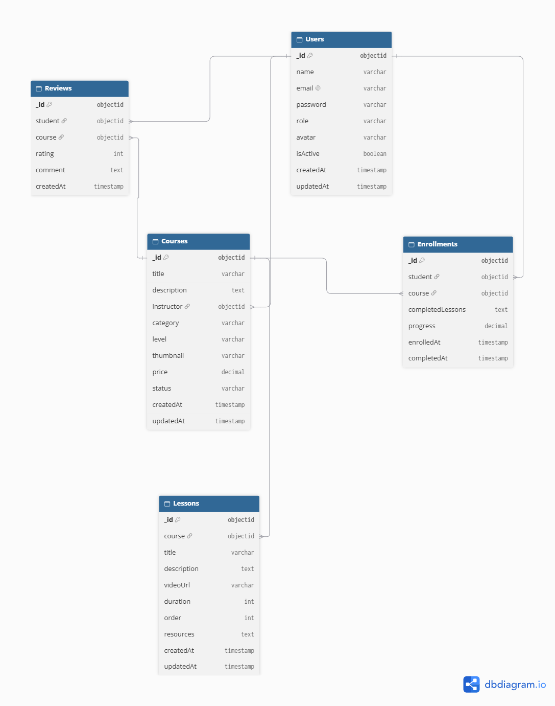

# EduCore – Enterprise Learning Management System

## 1. Project Overview

EduCore is a full-stack Enterprise Learning Management System (LMS) designed to provide an efficient platform for online learning, course management, student enrollment, and instructor administration.

The platform allows students to explore courses, watch lessons, track learning progress, and manage their enrollments. Instructors can create and manage courses and monitor student activity.

## 2. Designated Track

Fullstack Developer

## 3. Technology Stack

### Frontend
- React.js (Vite)
- Tailwind CSS
- React Router DOM
- Axios

### Backend
- Node.js
- Express.js
- MongoDB
- Mongoose
- JWT Authentication
- bcryptjs

### Design & Development Tools
- Figma
- dbdiagram.io
- Git and GitHub
- VS Code

## 4. Core Features

### Priority 0 – MVP
- User registration and login
- JWT-based authentication
- Role-based access (Student and Instructor)
- Protected routes
- Student dashboard
- Instructor dashboard

### Priority 1 – Core Functionality
- Course creation and management
- Course browsing and filtering
- Student course enrollment
- Lesson viewing interface
- Learning progress tracking
- Student activity monitoring

### Priority 2 – Advanced Features
- Course reviews and ratings
- Course search and categories
- Instructor analytics
- Responsive UI
- AI-powered learning recommendations

## 5. UI/UX Design – Figma

The application wireframes include:

1. Login and Signup Screens
2. Instructor Dashboard
3. Course Details / Lesson View

Figma Design: [View EduCore Designs](https://www.figma.com/design/1oQwL4SMcRW2PEdsFrOKlN/EduCore-%E2%80%94-Enterprise-LMS-UI-UX?node-id=1-3)

## 6. Database Architecture

The application uses MongoDB with the following collections:

- Users
- Courses
- Lessons
- Enrollments
- Reviews

The Entity Relationship Diagram (ERD) illustrates the relationships between these collections.

### Entity Relationship Diagram (ERD)

The following diagram illustrates the database structure
and relationships between EduCore collections.

## 7. Project Status

Currently in the planning and architecture phase (Sprint 13).
